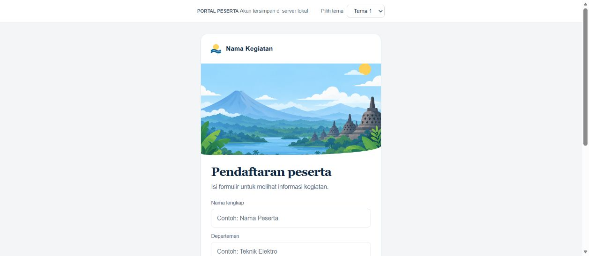

# Mock Up Portal Peserta

Project contoh portal kegiatan yang menampilkan alur peserta dari pendaftaran sampai persiapan acara.

## Tampilan beranda

## Fitur

1. Pilihan tema tampilan.
2. Contoh formulir pendaftaran dan login.
3. Informasi kegiatan, jadwal, dan checklist persiapan.

## Cara kerja

Buka `index.html` di browser untuk melihat demo. Formulir dalam salinan ini merupakan contoh antarmuka.
